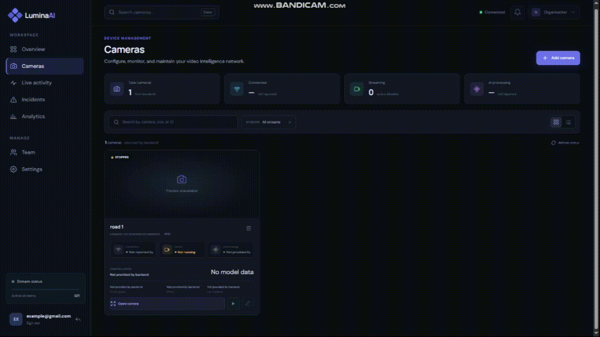

# CV Service — Backend

Backend for a video-surveillance service: user registration/authentication, adding RTSP cameras, live viewing over WebSocket, and per-frame processing with a YOLO model before the frame is sent to the client.

Stack: **FastAPI** + **SQLAlchemy (async)** + **JWT** + **OpenCV** + **YOLO**.

---

## Demo



*A short walkthrough of the frontend: adding a camera, starting/stopping the stream, and watching the live, YOLO-annotated video on the dashboard.*


---

## 1. Architecture

```
app/
├── routers/          # HTTP/WebSocket endpoints
│   ├── registration.py   # regular user + admin registration
│   ├── auth.py            # login, JWT issuing
│   ├── addNewCam.py       # add camera + one-shot frame preview
│   └── cameras.py         # start/stop stream, list active streams, live video over WS
├── models/            # SQLAlchemy models (DB tables)
│   ├── user_model.py      # UserTable
│   └── cameras_model.py   # UserCamerasTable
├── schemas/           # Pydantic request/response schemas
├── dependencies/
│   └── auth.py            # get_current_user — decodes the JWT from the Authorization header
├── services/
│   └── stream_manager.py  # background RTSP-reading threads + YOLO processing + frame buffer
├── utils/
│   ├── jwt_handler.py     # create_access_token / decode_access_token
│   ├── password_hash.py   # password hashing/verification
│   └── camera_helper.py   # single-frame capture for the preview endpoint
└── database/          # DB connection, initialization
```

All routers are mounted under the common prefix **`/api/v1`**.

---

## 2. Authentication

Standard JWT (Bearer token) flow.

| Step | What happens |
|---|---|
| Registration | `POST /api/v1/registration` — creates a user, password is hashed (`password_hash.py`); password and its repeat are cross-checked at the Pydantic level (`UserRegisterSchema.check_passwords_match`) |
| Admin registration | `POST /api/v1/registration/admin?secret_key=...` — same as above, but requires a secret key matching `settings.ADMIN_REGISTRATION_SECRET` and sets `is_admin=True` |
| Login | `POST /api/v1/login` — accepts `OAuth2PasswordRequestForm` (form-data: `username`, `password`; `username` = email), verifies the password and issues a JWT |
| Request auth | `get_current_user` (`dependencies/auth.py`) decodes the token from the `Authorization: Bearer <token>` header, extracts `sub` (user id), and loads that user from the DB |

Token payload: `{"sub": user.id, "email", "name", "is_admin", "exp"}`.

**Note:** the project uses two different JWT libraries in two different places — `python-jose` in `dependencies/auth.py` and `PyJWT` in `utils/jwt_handler.py`. The token format (HS256, same secret and algorithm) is unaffected, but if you touch the decoding logic, be aware which file uses which library.

---

## 3. Cameras

| Action | Endpoint |
|---|---|
| Add a camera | `POST /api/v1/newcam/` — body `{name, url}`, requires auth, returns `{id, user_id, name, url}` |
| Preview a frame | `POST /api/v1/newcam/preview` — body `{rtsp_url}`, connects to the RTSP source once (`camera_helper.capture_single_frame`, run in a threadpool so it doesn't block the event loop) and returns a single JPEG frame as base64 — **before** the camera is even saved to the DB |
| Start streaming | `POST /api/v1/cameras/{camera_id}/start` |
| Stop streaming | `POST /api/v1/cameras/{camera_id}/stop` |
| List active streams | `GET /api/v1/cameras/active-streams` → `{active_camera_ids, total_active}` |
| Live video | `WS /api/v1/cameras/{camera_id}/ws?token=<access_token>` |

There is currently **no** endpoint to list a user's cameras or to delete one — once a camera is created via `/newcam/`, it stays in the DB indefinitely (unless you've since added this — in that case, this doc is out of date on that point).

---

## 4. How streaming and YOLO processing work

The core is `app/services/stream_manager.py` — a singleton `stream_manager` holding:
- `_active_streams: dict[camera_id → {thread, stop_event}]` — one background `threading.Thread` per running camera;
- `_latest_frames: dict[camera_id → bytes]` — the most recent processed frame, JPEG-encoded and ready to send.

Pipeline inside `_camera_worker` (one instance per camera, in its own thread):

1. `cv2.VideoCapture(rtsp_url)` — connects to the camera, with auto-reconnect on drops.
2. `cap.read()` — reads the next raw frame.
3. **The frame is run through YOLO** — the model detects objects (people, etc.) on this frame, and the results (boxes, classes, confidence) are drawn directly onto the image **before** JPEG encoding. That's why the client receives an already-annotated frame — the frontend doesn't need to draw any detection boxes itself.
4. The processed frame is JPEG-encoded (`cv2.imencode`) and stored in `_latest_frames[camera_id]`, throttled to a fixed FPS (a constant in `stream_manager.py`) so the pipeline doesn't re-encode every single frame from the inner read loop — that would waste CPU with no benefit to the viewer.

`start_stream(camera_id, rtsp_url)` / `stop_stream(camera_id)` simply manage that thread's lifecycle (a `threading.Event` for stopping). `get_active_streams()` / `is_active()` read the current state without blocking other operations.

### WebSocket delivery (`cameras.py`)

```
WS /api/v1/cameras/{camera_id}/ws?token=<access_token>
```

- The token is passed **as a query parameter**, not a header — the native browser `WebSocket` API can't send an `Authorization` header. It's validated with the same `decode_access_token` function used for HTTP requests.
- If the stream for that camera isn't running, the connection is closed immediately with a custom code `4404`; an invalid token closes it with `4401`.
- Once connected, the loop pulls the latest frame from `stream_manager.get_latest_frame(camera_id)` and, if it's newer than the last one sent, forwards it as **raw bytes** (`websocket.send_bytes`) — no JSON/base64 wrapper, which keeps it fast and light on the wire.
- Multiple viewers of the same camera don't need multiple RTSP connections — every connected WebSocket session reads from the same frame buffer.

---

## 5. Environment variables / settings (`config.py`)

Based on how they're used in the code, at minimum these are expected:

```
JWT_SECRET_KEY=...
JWT_ALGORITHM=HS256
JWT_EXPIRE_MINUTES=...
ADMIN_REGISTRATION_SECRET=...
```

plus DB connection settings (an `AsyncSession` is used, so an async driver is expected, e.g. `asyncpg` for PostgreSQL).

---

## 6. Known limitations

- No `GET /api/v1/cameras` (list a user's cameras) or `DELETE /api/v1/cameras/{id}` — the frontend has to cache the camera list on its own side.
- The streaming WebSocket endpoint doesn't check that the camera actually belongs to the authenticated user — any authenticated user can connect to any `camera_id` if they know it. Worth adding a `camera.user_id == current_user.id` check before `accept()`.
- One background `threading.Thread` per camera — with a large number of concurrent cameras, consider moving to a process pool (see the separate discussion on scaling to 100+ concurrent viewers).
